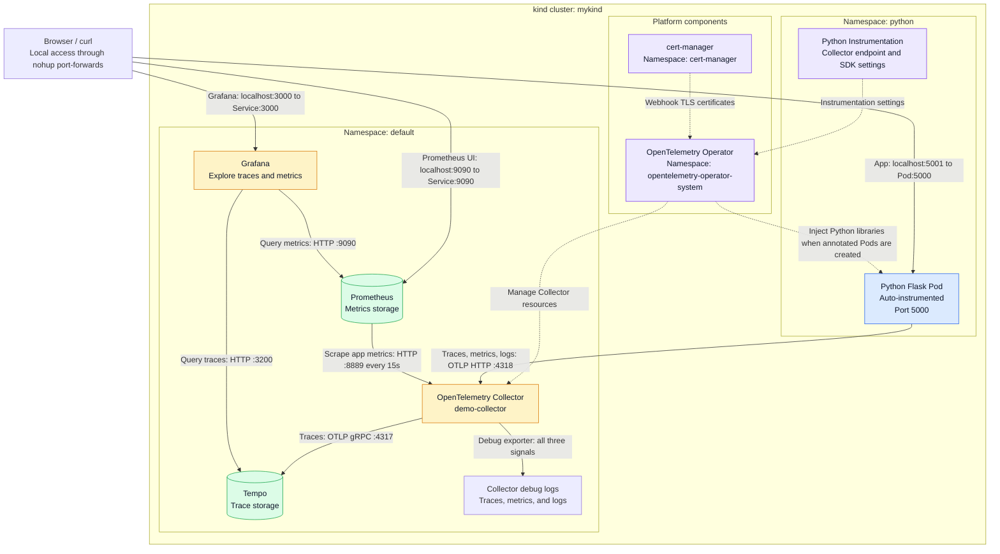

# OpenTelemetry on Kubernetes: Python Quick Start

Run a Python service on kind, view traces and metrics in Grafana, and check
logs in Collector output. No application image build is needed.

## Architecture



Solid arrows show telemetry or query/request traffic; dotted arrows show
configuration and management. Prometheus pulls metrics from the Collector;
Grafana queries Tempo and Prometheus. Logs remain in Collector output.

| Resource | Namespace |
| --- | --- |
| cert-manager | `cert-manager` |
| OpenTelemetry Operator | `opentelemetry-operator-system` |
| Collector `demo` | `default` |
| Tempo, Prometheus, and Grafana | `default` |
| Python Deployment and Instrumentation | `python` |

Use **PowerShell** unless a block is marked **Bash**, from this repository's root.
Install Docker Desktop (Linux
containers), kubectl, and kind first. Skip installations already present and
healthy; verify your Kubernetes context before applying files.

## Automated setup

From **Git Bash** on Windows, or Bash on Linux/macOS:

```bash
bash setup.sh
```

[setup.sh](./setup.sh) creates `mykind` if needed, installs the components in
order, and waits for readiness. It targets `kind-mykind`, reuses the matching
operator, and stops on errors. Rerunning updates the manifests and restarts the
Python service to pick up instrumentation changes. Grafana also restarts to
reload its provisioned data sources. A different existing operator version
requires manual review.

The script starts and checks three `nohup` port-forwards: Python on `5001`,
Grafana on `3000`, and Prometheus on `9090`. Logs and PIDs are saved in
`.port-forward/` (ignored by Git). Stop existing recorded forwards before
rerunning setup. Use Step 5 to generate traffic; the setup steps below are the
manual alternative.

## 1. Create a kind cluster

Skip creation if `mykind` already exists:

```powershell
kind create cluster --name mykind
kubectl config use-context kind-mykind
kubectl get nodes
```

## 2. Install cert-manager

```powershell
kubectl apply -f https://github.com/cert-manager/cert-manager/releases/download/v1.21.3/cert-manager.yaml
kubectl rollout status deployment/cert-manager -n cert-manager --timeout=180s
kubectl rollout status deployment/cert-manager-cainjector -n cert-manager --timeout=180s
kubectl rollout status deployment/cert-manager-webhook -n cert-manager --timeout=180s
```

## 3. Install the OpenTelemetry Operator

[otel-operator.yaml](./otel-operator.yaml) is the unmodified
[official v0.163.0 installation bundle](https://github.com/open-telemetry/opentelemetry-operator/releases/download/v0.163.0/opentelemetry-operator.yaml),
saved locally with a shorter filename. It installs:

- The operator Deployment in `opentelemetry-operator-system`.
- CRDs that add resources such as `OpenTelemetryCollector` and `Instrumentation`.
- Service accounts and RBAC permissions for the operator.
- Admission webhooks, Services, and cert-manager certificate resources for injection.

The operator manages Collector instances and injects Python instrumentation into
annotated Pods when they are created. It does not receive application telemetry;
the Collector does that. Installing this bundle alone does not create the
`demo` Collector or instrument the Python app; Step 4 configures those.

```powershell
kubectl apply --server-side -f .\otel-operator.yaml
kubectl rollout status deployment/opentelemetry-operator-controller-manager -n opentelemetry-operator-system --timeout=180s
kubectl wait --for=condition=Established crd/opentelemetrycollectors.opentelemetry.io crd/instrumentations.opentelemetry.io --timeout=120s
```

Skip this step if the matching operator is already installed and healthy.

## 4. Deploy storage, Grafana, the Collector, and Python

Create the namespace first so Instrumentation exists before the application
Pods. The Deployment file also declares the namespace.

```powershell
kubectl apply -f .\tempo.yaml
kubectl rollout status deployment/tempo -n default --timeout=300s
kubectl apply -f .\prometheus.yaml
kubectl rollout status deployment/prometheus -n default --timeout=300s
kubectl apply -f .\grafana.yaml
kubectl rollout restart deployment/grafana -n default
kubectl rollout status deployment/grafana -n default --timeout=300s
kubectl apply -f .\otel-collector.yaml
kubectl wait --for=condition=Ready opentelemetrycollector/demo -n default --timeout=180s
kubectl rollout status deployment/demo-collector -n default --timeout=180s
kubectl create namespace python --dry-run=client -o yaml | kubectl apply -f -
kubectl apply -f .\python-instrumentation.yaml
kubectl apply -f .\python-deployment.yaml
kubectl rollout status deployment/python-otel -n python --timeout=300s
```

| File | Purpose |
| --- | --- |
| [otel-operator.yaml](./otel-operator.yaml) | Install the operator, CRDs, permissions, and webhooks (Step 3) |
| [tempo.yaml](./tempo.yaml) | Store and query traces |
| [prometheus.yaml](./prometheus.yaml) | Scrape and store application metrics from the Collector |
| [grafana.yaml](./grafana.yaml) | Grafana UI with Tempo and Prometheus data sources already configured |
| [otel-collector.yaml](./otel-collector.yaml) | Export traces to Tempo, expose metrics to Prometheus, and print all three signals |
| [python-instrumentation.yaml](./python-instrumentation.yaml) | Configure Python instrumentation and the collector endpoint |
| [python-deployment.yaml](./python-deployment.yaml) | Create namespace `python` and run an inline Flask app using official `python:3.12-slim` |

The app installs Flask at startup, so each new container needs internet access.
A startup probe allows time for installation. This is a learning convenience,
not a production packaging approach.

### Two important settings

**Collector address:** the app is in `python`, while the collector is in
`default`, so the Instrumentation uses the cross-namespace address:

```text
http://demo-collector.default.svc.cluster.local:4318
```

**Annotation:** put it on the Deployment's **Pod template**, not only on the
Deployment's top-level metadata:

```yaml
spec:
  template:
    metadata:
      annotations:
        instrumentation.opentelemetry.io/inject-python: "true"
```

If multiple Instrumentation resources exist in `python`, use
`"python-instrumentation"` instead of `"true"` to select this one explicitly.

## 5. Generate traffic and view telemetry

### Background port-forwards

Setup starts these automatically. For a manual setup, run the following in
**Git Bash** on Windows, or Bash on Linux/macOS, not PowerShell:

```bash
mkdir -p .port-forward
nohup kubectl --context kind-mykind port-forward deployment/python-otel 5001:5000 -n python --address 127.0.0.1 > .port-forward/python.log 2>&1 < /dev/null &
echo $! > .port-forward/python.pid
nohup kubectl --context kind-mykind port-forward service/grafana 3000:3000 -n default --address 127.0.0.1 > .port-forward/grafana.log 2>&1 < /dev/null &
echo $! > .port-forward/grafana.pid
nohup kubectl --context kind-mykind port-forward service/prometheus 9090:9090 -n default --address 127.0.0.1 > .port-forward/prometheus.log 2>&1 < /dev/null &
echo $! > .port-forward/prometheus.pid
```

| App | URL |
| --- | --- |
| Python | http://localhost:5001/otel-test |
| Grafana | http://localhost:3000 |
| Prometheus | http://localhost:9090 |

Inspect `.port-forward/*.log` if a port is already in use or a forward exits.
`nohup` keeps forwards running after the shell exits; it does not restart them
if a Pod is replaced or the cluster connection drops.

To stop them in Bash, first confirm the recorded PIDs still belong to these
`kubectl` forwards, then run:

```bash
kill "$(cat .port-forward/python.pid)"
kill "$(cat .port-forward/grafana.pid)"
kill "$(cat .port-forward/prometheus.pid)"
```

### Generate traffic

Send requests from PowerShell:

```powershell
1..10 | ForEach-Object {
    Invoke-WebRequest http://localhost:5001/otel-test -UseBasicParsing | Out-Null
}
```

Watch the collector in another terminal:

```powershell
kubectl logs -n default deployment/demo-collector --follow --since=2m
```

Look for positive counts:

| Signal | Collector output |
| --- | --- |
| Traces | `Traces` and `spans` |
| Metrics | `Metrics` and `data points` |
| Logs | `Logs` and `log records` |

Allow a few seconds for traces/logs and at least a minute for metrics. Health
probes also generate requests. The sample app emits a Python warning log per
request to make log export easy to test.

For individual span IDs, attributes, and log bodies, change
`debug.verbosity` from `basic` to `detailed` in
[otel-collector.yaml](./otel-collector.yaml), reapply it, and follow the current
collector logs. Detailed output may expose application data.

### What is Tempo?

**Grafana Tempo is a tracing backend:** it stores traces and lets Grafana search
and retrieve them. A **trace** describes a request's journey through an
application; its **spans** describe individual operations and their duration.
Across microservices, propagated trace context links those spans into one trace.

In this setup:

- The Python app generates traces through OpenTelemetry auto-instrumentation.
- The Collector receives them and forwards them to Tempo using OTLP/gRPC on
  port `4317`.
- Grafana queries Tempo's HTTP API on port `3200` and displays the spans and
  timing. **Tempo stores the traces; Grafana provides the UI.**

Tempo does not store this app's metrics or logs. Prometheus stores metrics;
logs currently appear only in Collector output. The [Tempo manifest](./tempo.yaml)
uses temporary Pod storage, so its traces disappear when the Pod is replaced.

### View traces in Grafana

Open **http://localhost:3000**; no login is needed for this local demo.
Choose **Explore > Tempo**, select the last 15 minutes, and run this TraceQL query:

```traceql
{ resource.service.name = "python-otel" }
```

Generate fresh app requests, allow a few seconds for export, then refresh.
Select a trace to inspect its spans and timing.

Grafana queries Tempo; it does not read traces from the collector's logs.

### View metrics in Grafana

In the same Grafana instance, choose **Explore > Prometheus** and run:

```promql
{service_name="python-otel"}
```

Generate app requests and allow 60-90 seconds for Python's periodic metrics
export and Prometheus scraping. Switch to a graph to see values over time.
To find HTTP request measurements, use:

```promql
{service_name="python-otel", __name__=~"http_.*"}
```

Prometheus scrapes the Collector's application-metrics exporter on port `8889`,
not the Collector's internal monitoring port `8888`. The exporter includes
resource attributes as labels, including `service_name`.
Logs still appear only in Collector output; a logs backend such as Loki is not
included.

## Troubleshooting

Start with application logs and Pod details:

```powershell
kubectl logs -n python deployment/python-otel -c python-otel --tail=100
kubectl describe pods -n python -l app=python-otel
kubectl exec -n python deployment/python-otel -c python-otel -- printenv OTEL_EXPORTER_OTLP_ENDPOINT
```

- **No injection:** check the Pod-template annotation and the Instrumentation
  resource in `python`. Pod details should show the
  `opentelemetry-auto-instrumentation-python` init container.
- **Instrumentation changed:** existing Pods keep their injected settings.
  Recreate them:

  ```powershell
  kubectl rollout restart deployment/python-otel -n python
  kubectl rollout status deployment/python-otel -n python --timeout=300s
  ```

- **Only collector startup messages:** readiness is not proof of received data.
  Check application errors, the injected endpoint, and the matching signal
  pipeline.
- **Container logs but no OTLP logs:** this setup exports Python logging records,
  not arbitrary stdout or `print()` output. General container log collection
  needs a separate setup, such as a `filelog` receiver.
- **No traces in Grafana:** generate fresh requests and check the time range,
  Tempo readiness, and Collector export errors. Traces received before Tempo was
  configured are not backfilled from Collector logs.
- **No metrics in Grafana:** allow 60-90 seconds after making requests. Check
  Prometheus readiness and its scrape target, and confirm the Collector Service
  exposes port `8889`. Rerun setup to reload the Grafana data sources.

## Notes

- One collector can serve multiple microservices; give each a distinct
  `service.name`.
- Tempo uses temporary Pod storage: traces are lost when its Pod is replaced.
  Prometheus metrics and Grafana's local database are temporary too; both Grafana
  data sources are provisioned automatically at startup.
- Grafana allows anonymous Editor access for Explore. Keep it internal and use
  localhost port-forward only; configure authentication before exposing it.
- Local demo only: Flask's development server and unauthenticated OTLP endpoints
  are not production-ready. Review pinned component versions before upgrading.

## Official references

- [kind installation](https://kind.sigs.k8s.io/docs/user/quick-start/)
- [cert-manager installation](https://cert-manager.io/docs/installation/)
- [OpenTelemetry Operator](https://opentelemetry.io/docs/platforms/kubernetes/operator/)
- [Collector and automatic instrumentation](https://opentelemetry.io/docs/platforms/kubernetes/operator/automatic/)
- [Tempo data source](https://grafana.com/docs/grafana/latest/datasources/tempo/configure-tempo-data-source/)
- [Prometheus data source](https://grafana.com/docs/grafana/latest/datasources/prometheus/)
